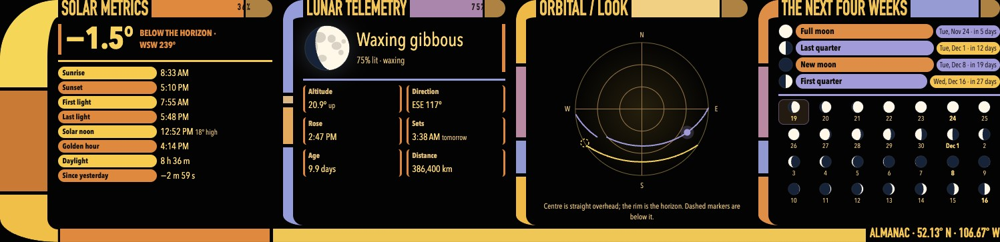
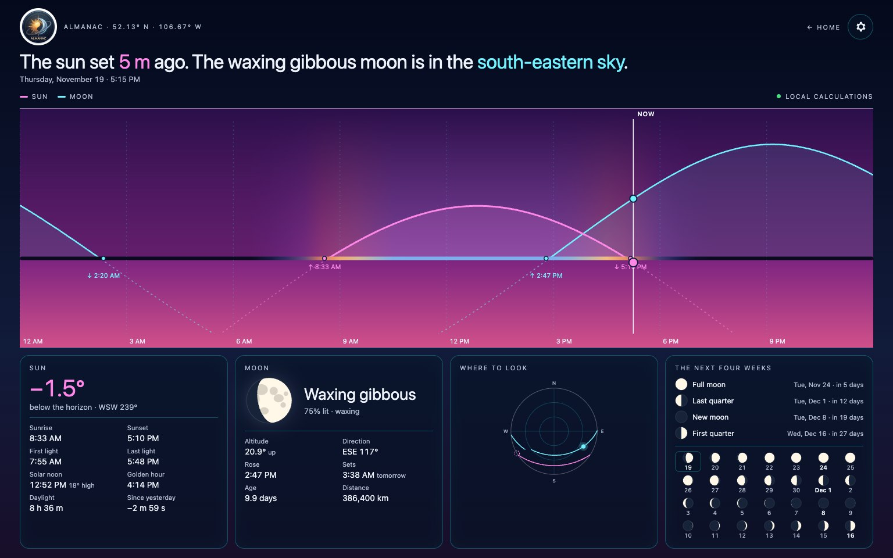
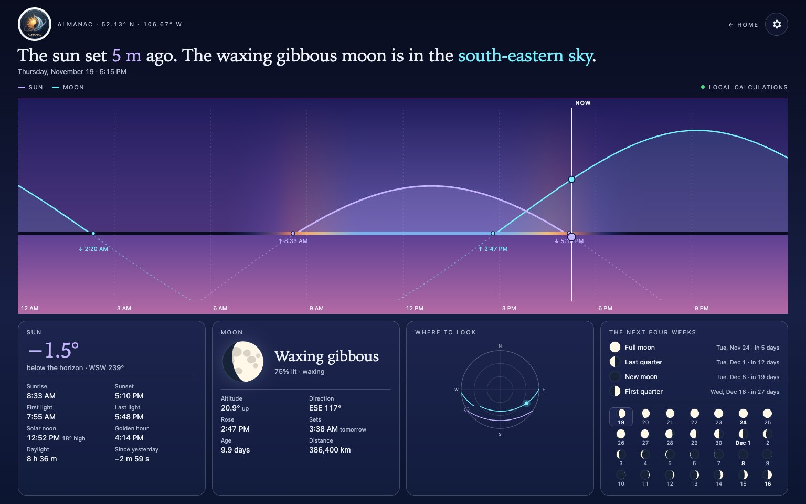
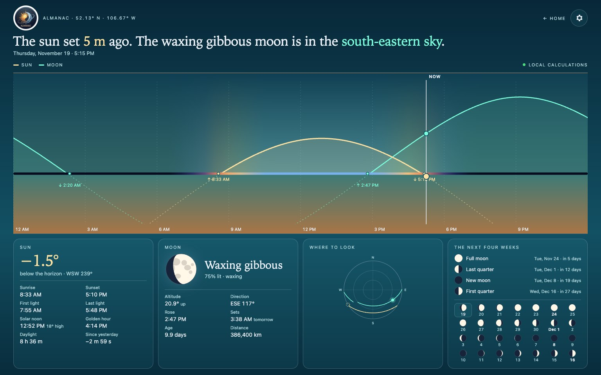
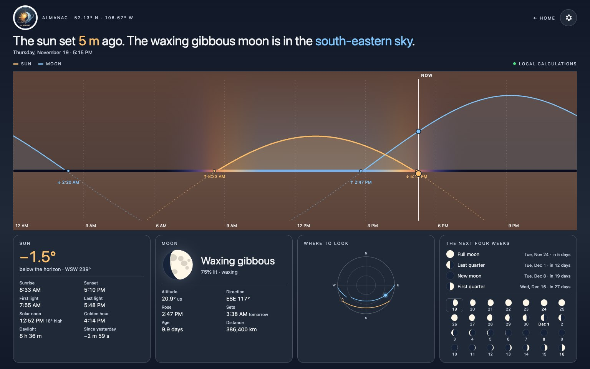
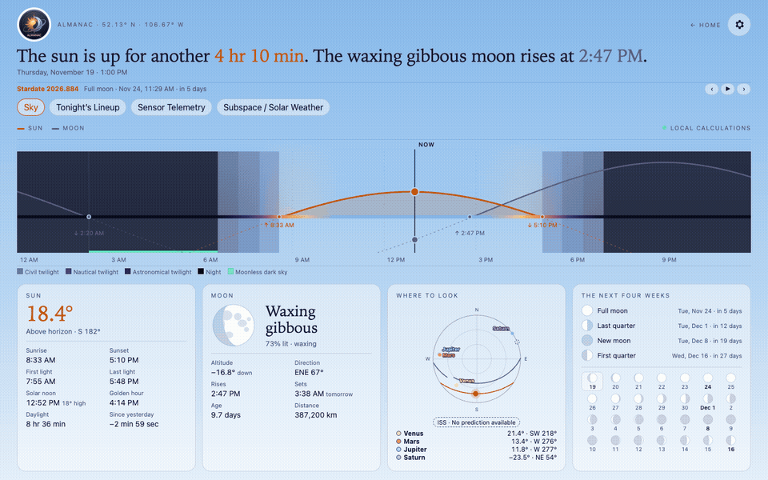
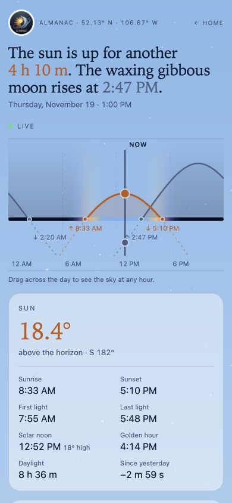
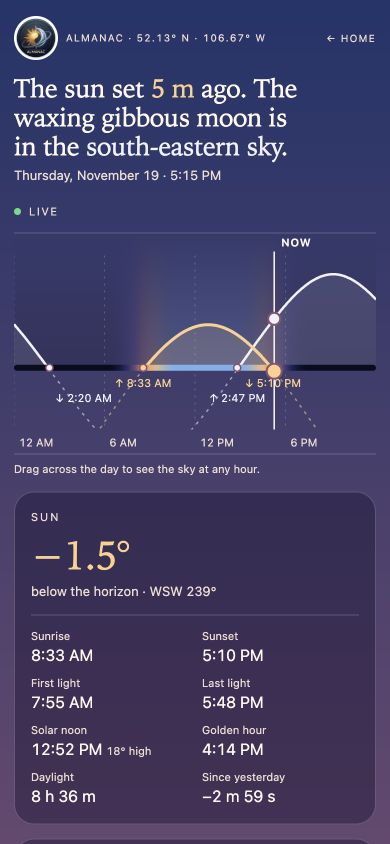

# Home Assistant Almanac

<p align="center">
  
</p>

A local sun and moon integration for Home Assistant, with continuously updated sensors and a bundled interactive dashboard card.

[](https://my.home-assistant.io/redirect/hacs_repository/?owner=yanke7&repository=Home-Assistant-Almanac&category=integration)


## Theme gallery

Choose a theme with the gear on the card. These previews show the same sunset in Saskatoon so you can compare palettes. Select an image to see it full size.

### Star Trek

[](https://raw.githubusercontent.com/yanke7/Home-Assistant-Almanac/main/assets/screenshots/themes/trek.jpg)

[](https://raw.githubusercontent.com/yanke7/Home-Assistant-Almanac/main/assets/screenshots/themes/trek-instruments.jpg)

| Original | Brushed Steel |
| --- | --- |
| [](https://raw.githubusercontent.com/yanke7/Home-Assistant-Almanac/main/assets/screenshots/themes/original.jpg) | [](https://raw.githubusercontent.com/yanke7/Home-Assistant-Almanac/main/assets/screenshots/themes/steel.jpg) |

| Amber Relay | Neon Grid |
| --- | --- |
| [](https://raw.githubusercontent.com/yanke7/Home-Assistant-Almanac/main/assets/screenshots/themes/relay.jpg) | [](https://raw.githubusercontent.com/yanke7/Home-Assistant-Almanac/main/assets/screenshots/themes/neon.jpg) |

| Midnight Drift | Aqua Current |
| --- | --- |
| [](https://raw.githubusercontent.com/yanke7/Home-Assistant-Almanac/main/assets/screenshots/themes/abyss.jpg) | [](https://raw.githubusercontent.com/yanke7/Home-Assistant-Almanac/main/assets/screenshots/themes/tide.jpg) |

### Follow Appearance

This preview shows the fallback colours. With the Appearance dashboard resource loaded, Almanac follows your shared palette, font and text size.

[](https://raw.githubusercontent.com/yanke7/Home-Assistant-Almanac/main/assets/screenshots/themes/appearance.jpg)

## Watch the sky change



A looping preview of the actual card at four times of day. The colours follow the sun automatically. [View still screenshots](#from-daylight-to-night).

## Almanac on your phone

The same card adapts to a narrow screen, with a touch-friendly sky chart and vertically stacked panels. Captured at a 390 × 844 phone viewport using the demo location and date. Tap a screenshot to see the complete scrolling view, including the moon, sky map, and phase calendar.

| Daylight | Sunset | Night |
| --- | --- | --- |
| [](https://raw.githubusercontent.com/yanke7/Home-Assistant-Almanac/main/assets/screenshots/phone-daylight-full.jpg) | [](https://raw.githubusercontent.com/yanke7/Home-Assistant-Almanac/main/assets/screenshots/phone-sunset-full.jpg) | [](https://raw.githubusercontent.com/yanke7/Home-Assistant-Almanac/main/assets/screenshots/phone-night-full.jpg) |

Almanac uses your Home Assistant latitude, longitude, and time zone. The backend updates its sensors every minute, even with all browsers closed. The bundled card uses the same backend readings for its live display and matching local calculations for interactive previews. No external astronomy APIs, API keys, or subscriptions are required.

- A plain-language summary of the next sun and moon events.
- An interactive daily altitude chart: drag or use arrow keys to explore; Escape returns to now.
- Sun elevation, first and last light, solar noon, golden hour, and daylight change.
- Moon phase, tilt, altitude, direction, rise and set, age, and distance.
- A sky map and four-week moon phase calendar.
- Almanac logo in the header, bundled into the card for offline use.
- Colors that follow night, twilight, golden hour, and daylight.
- A responsive full-page layout with scrolling on phones.

## From daylight to night

The card changes its colours automatically with the sun’s elevation. These screenshots show the actual card with demo data for Saskatoon on November 19, 2026, including the bundled Almanac logo.

### Daylight · 1:00 PM

Clear blue skies and light panels.


### Sunset · 5:15 PM

Warm orange and rose tones as the sun slips below the horizon.


### Twilight · 6:00 PM

Purple and indigo tones after sunset.


### Night · 9:00 PM

Deep navy panels, stars, and a glowing moon.


## Install with Marketplace or HACS

Requires Home Assistant **2026.1.0 or newer** (Almanac v2.3.1 onward).

1. Use the badge above, or add `https://github.com/yanke7/Home-Assistant-Almanac` as a custom repository with category **Integration**.
2. Download Almanac. Restart Home Assistant if requested so it discovers the new integration.
3. Go to **Settings → Devices & services → Add integration → Almanac** and confirm setup.
4. Add **Almanac Sky** to a panel dashboard view using the YAML below. The card loads automatically; no separate card download or dashboard resource is needed.

Almanac reads **Settings → System → General** for your home location and time zone. Changes are picked up within a minute. One Almanac entry is supported per Home Assistant instance.

The repository can be installed by URL while catalog review is pending. The integration includes its logo for integration and Marketplace branding.

## Themes and settings

Use the **Settings** gear beside Home on the Almanac card to choose a theme. The choice applies immediately and is remembered in this browser; different phones and wall displays can use different themes.

**Original** is the default and preserves the automatic daylight, sunset, twilight, and night colours. Other options are **Brushed Steel**, **Amber Relay**, **Neon Grid**, **Midnight Drift**, **Aqua Current**, **Star Trek**, and **Follow Appearance**. Follow Appearance uses the shared palette, font, and text size when the Appearance dashboard resource is loaded. Otherwise it uses your active Home Assistant colours and font. The theme only changes appearance; sensors and astronomical calculations stay the same.

## Sensors for automations

Find all **35 sensors and 3 binary sensors** under **Settings → Devices & services → Almanac → Devices → Almanac**. Use them as automation triggers or conditions. They update every minute with the dashboard closed. Dragging the chart previews another time only in that browser. Names below use the default IDs; Home Assistant may add a suffix if an ID already exists.

| Entities | Values |
| --- | --- |
| `sensor.almanac_sun_elevation`, `sensor.almanac_sun_azimuth` | Degrees |
| `sensor.almanac_moon_elevation`, `sensor.almanac_moon_azimuth` | Degrees |
| `sensor.almanac_moon_phase`, `sensor.almanac_moon_illumination` | Phase state (listed below) and illumination percentage |
| `sensor.almanac_moon_age`, `sensor.almanac_moon_distance` | Days and kilometres |
| `sensor.almanac_daylight_duration`, `sensor.almanac_daylight_change` | Minutes of daylight; change in seconds since yesterday |
| `sensor.almanac_sky_period` | `day`, `golden`, `twilight`, or `night` |
| `sensor.almanac_next_sunrise`, `sensor.almanac_next_sunset` | Upcoming timestamps |
| `sensor.almanac_next_dawn`, `sensor.almanac_next_dusk` | Civil twilight timestamps |
| `sensor.almanac_next_solar_noon`, `sensor.almanac_next_evening_golden_hour` | Upcoming timestamps; evening golden hour begins at 6° solar elevation |
| `sensor.almanac_next_moonrise`, `sensor.almanac_next_moonset` | Upcoming timestamps |
| `binary_sensor.almanac_sun_above_horizon`, `binary_sensor.almanac_moon_above_horizon` | Above the apparent horizon |

| Additional dashboard entities (v2.3+) | Values |
| --- | --- |
| `sensor.almanac_sun_direction`, `sensor.almanac_moon_direction` | 16 compass points, clockwise from `N` through `NNE`, `NE`, … to `NNW` |
| `sensor.almanac_daylight_percentage` | Percentage of the current local day spent above the solar horizon, accounting for daylight-saving changes |
| `sensor.almanac_solar_noon_elevation` | Today's maximum sampled solar elevation in degrees |
| `binary_sensor.almanac_moon_waxing` | `on` during the waxing half of the lunar cycle and `off` during the waning half |
| `sensor.almanac_today_sunrise`, `sensor.almanac_today_sunset` | Today's sunrise and sunset |
| `sensor.almanac_today_dawn`, `sensor.almanac_today_dusk` | Today's first and last civil light |
| `sensor.almanac_today_solar_noon`, `sensor.almanac_today_evening_golden_hour` | Today's solar noon and evening descent through 6° |
| `sensor.almanac_today_moonrise`, `sensor.almanac_today_moonset` | First rise and set on today's local date |
| `sensor.almanac_next_new_moon`, `sensor.almanac_next_first_quarter`, `sensor.almanac_next_full_moon`, `sensor.almanac_next_last_quarter` | Upcoming phase timestamps from the lunar calendar |

The **today** timestamps keep their value after the event until local midnight. An event that does not occur today is `unknown`. The **next** timestamps roll forward after the event. The moon phase states are `new_moon`, `waxing_crescent`, `first_quarter`, `waxing_gibbous`, `full_moon`, `waning_gibbous`, `last_quarter`, and `waning_crescent`.

Upcoming sunrise, twilight, solar noon, golden hour and moonrise/set sensors search the remainder of today and the following two local days. When no event occurs in that window (for example during polar night), the event is `unknown`. Daylight duration still reports zero or the full local-day length during polar night/day. Values are approximate and not intended for navigation. Sensor timestamps are stored in UTC and displayed in your Home Assistant time zone.

If the backend is temporarily unavailable, the card labels its browser-only fallback **Local calculations**. That fallback does not update sensor entities.

## Example automations

Each block is one automation. In **Settings → Automations & scenes**, create an empty automation, open **Edit in YAML**, and paste one example. Replace the example light with your own entity ID.

### Turn on a porch light when evening twilight begins

The transition from golden hour to twilight selects the evening crossing.

```yaml
alias: Almanac - Porch light at evening twilight
triggers:
  - trigger: state
    entity_id: sensor.almanac_sky_period
    from: "golden"
    to: "twilight"
actions:
  - action: light.turn_on
    target:
      entity_id: light.porch
```

### Notify when a bright moon rises

This checks illumination at moonrise. The notification appears in Home Assistant.

```yaml
alias: Almanac - Bright moon rising
triggers:
  - trigger: state
    entity_id: binary_sensor.almanac_moon_above_horizon
    from: "off"
    to: "on"
conditions:
  - condition: numeric_state
    entity_id: sensor.almanac_moon_illumination
    above: 80
actions:
  - action: persistent_notification.create
    data:
      title: Bright moon rising
      message: >-
        Look {{ states('sensor.almanac_moon_direction') }}.
        The moon is {{ states('sensor.almanac_moon_illumination') | float(0) | round(0) | int }}% illuminated.
```

### Schedule a reminder at the predicted full moon

Use a time trigger to fire at the timestamp held by an event sensor.

```yaml
alias: Almanac - Full moon reminder
triggers:
  - trigger: time
    at: sensor.almanac_next_full_moon
actions:
  - action: persistent_notification.create
    data:
      title: Full moon
      message: The moon has reached its predicted full phase.
```

## Configure

Use a panel view for the full-page design:

```yaml
views:
  - title: Almanac
    path: almanac
    type: panel
    cards:
      - type: custom:almanac-sky-card
        home_path: /lovelace/0
```

For an existing panel view, add this card in its YAML editor:

```yaml
type: custom:almanac-sky-card
```

| Option | Default | Description |
| --- | --- | --- |
| `type` | Required | `custom:almanac-sky-card` |
| `home_path` | `/lovelace/0` | Local dashboard path for the Home link. |

The location and time zone come from Home Assistant's general settings. Dates and times follow your frontend locale; descriptive text is in English. Astronomical values are approximate.

## Manual installation

Copy `custom_components/almanac` from the latest release into `/config/custom_components/almanac`, restart Home Assistant, then add **Almanac** under **Settings → Devices & services**. The dashboard JavaScript and logo are included in that folder.

## Migrating from the 1.x standalone card

Version 2 combines the dashboard card and sensors in one integration. The card type remains `custom:almanac-sky-card`; existing views and `home_path` settings can be kept.

1. Save your current resource URL and dashboard YAML so you can return to version 1.0.3 if needed.
2. Download the 2.x release ZIP and copy `custom_components/almanac` to your Home Assistant configuration directory. Restart and add the integration under Devices & services. Verify the Almanac sensors are available.
3. Remove the old standalone card download from Marketplace/HACS (or remove its manual dashboard resource). Keep the dashboard view itself. The integration now supplies the card automatically.
4. If the repository is still registered as **Dashboard**, remove that custom-repository registration and add the same repository as **Integration**, then download the 2.x version for future updates.
5. Reload your browser. If an old card is still loaded, hard-refresh it. The live card and sensors now use the integration.

For a fresh installation, use the normal Integration instructions above. Do not register both the standalone card resource and the bundled card.

Rollback: disable the Almanac integration, reinstall the **Dashboard** package at `v1.0.3` (or restore its saved JavaScript module resource), restart Home Assistant, and reload the browser. Existing dashboard YAML remains compatible.

## Development

To test the minimum supported version, install `homeassistant==2026.1.0` with Python 3.13. CI also runs the backend tests with `homeassistant==2026.11.0` in a Python 3.14 virtual environment. No JavaScript build step or npm dependencies are required. Keep the root `almanac-sky-card.js` and `custom_components/almanac/www/almanac-sky-card.js` identical when editing the card. Serve this directory with `python3 -m http.server 8000`, then open `http://localhost:8000/preview.html` for a demo with sample location data. Add `?time=2026-11-19T23:15:00Z` to freeze the demo clock for a reproducible sunset preview; this affects only the demo page.

```sh
node --check almanac-sky-card.js
node verify-day.cjs
node tests/verify-backend.cjs
python -m unittest discover -s tests -p 'test_*.py'
```

The regression checks cover short, long, and ordinary local days, a half-hour time zone, chart bounds, keyboard/pointer selection, and calendar dates. GitHub Actions also validates the repository with the HACS action.

## License

GNU General Public License v3.0 only. See [LICENSE](LICENSE).
