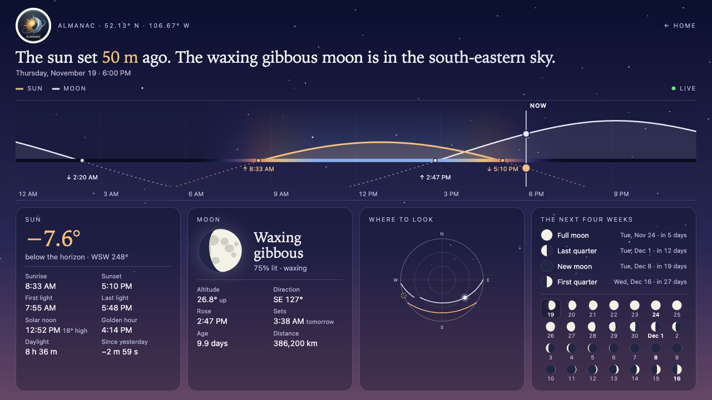

# Home Assistant Almanac

<p align="center">
  
</p>

A self-contained sun and moon dashboard card for Home Assistant. Originally published as **Fable Sun Moon**.

[](https://my.home-assistant.io/redirect/hacs_repository/?owner=yanke7&repository=Home-Assistant-Almanac&category=plugin)


Almanac computes the sky from your Home Assistant latitude, longitude, and time zone. It needs no sensor entities, API keys, external libraries, or services.

- A plain-language summary of the next sun and moon events.
- An interactive daily altitude chart: drag or use arrow keys to explore; Escape returns to now.
- Sun elevation, first and last light, solar noon, golden hour, and daylight change.
- Moon phase, tilt, altitude, direction, rise and set, age, and distance.
- A sky map and four-week moon phase calendar.
- Almanac logo in the header, bundled into the card for offline use.
- Colors that follow night, twilight, golden hour, and daylight.
- A responsive full-page layout with scrolling on phones.

## From daylight to night

The card changes its colours automatically with the sun’s elevation. These screenshots show the actual card with demo data for Saskatoon on November 19, 2026, including the bundled Almanac logo.

### Daylight · 1:00 PM

Clear blue skies and light panels.


### Sunset · 5:15 PM

Warm orange and rose tones as the sun slips below the horizon.


### Twilight · 6:00 PM

Purple and indigo tones after sunset.



### Night · 9:00 PM

Deep navy panels, stars, and a glowing moon.


## Install with Marketplace or HACS

Use the badge above, or add `https://github.com/yanke7/Home-Assistant-Almanac` as a custom repository with category **Dashboard** (internally `plugin`). Download the card, then reload your browser.

The repository can be installed by URL before it is accepted into the searchable catalog.

If the resource was not registered automatically, add it under **Settings → Dashboards → Resources** (enable Advanced Mode in your profile if needed):

- URL: `/hacsfiles/Home-Assistant-Almanac/almanac-sky-card.js`
- Type: **JavaScript module**

## Configure

Use a panel view for the full-page design:

```yaml
views:
  - title: Almanac
    path: almanac
    type: panel
    cards:
      - type: custom:almanac-sky-card
        home_path: /lovelace/0
```

For an existing panel view, add this card in its YAML editor:

```yaml
type: custom:almanac-sky-card
```

| Option | Default | Description |
| --- | --- | --- |
| `type` | Required | `custom:almanac-sky-card` |
| `home_path` | `/lovelace/0` | Local dashboard path for the Home link. |

The location and time zone come from Home Assistant's general settings. Dates and times follow your frontend locale; descriptive text is in English. Astronomical values are approximate.

## Manual installation

1. Download `almanac-sky-card.js` from the latest release.
2. Copy it into `/config/www/`.
3. Add `/local/almanac-sky-card.js` as a JavaScript module resource.
4. Reload the browser and add the card as shown above.

### Migrating from Fable Sun Moon

The card type is unchanged: `custom:almanac-sky-card`. Install this repository, remove the old `/local/` resource entry to avoid loading two copies, and reload. Keep your existing `home_path` if it points to your own dashboard.

## Development

No build step or npm dependencies are required. Serve this directory with `python3 -m http.server 8000`, then open `http://localhost:8000/preview.html` for a demo with sample location data. Add `?time=2026-11-19T23:15:00Z` to freeze the demo clock for a reproducible sunset preview; this affects only the demo page.

```sh
node --check almanac-sky-card.js
node verify-day.cjs
```

The regression checks cover short, long, and ordinary local days, a half-hour time zone, chart bounds, keyboard/pointer selection, and calendar dates. GitHub Actions also validates the repository with the HACS action.

## License

GNU General Public License v3.0 only. See [LICENSE](LICENSE).

Original project: [Fable Sun Moon](https://github.com/yanke7/Home-Assistant/tree/main/Other%20Home%20Assistant%20Projects/Fable%20Sun%20Moon).
