# Home Assistant Almanac

<p align="center">
  
</p>

A local sun and moon integration for Home Assistant, with continuously updated sensors and a bundled interactive dashboard card.

[](https://my.home-assistant.io/redirect/hacs_repository/?owner=yanke7&repository=Home-Assistant-Almanac&category=integration)


## Watch Almanac in 30 seconds

[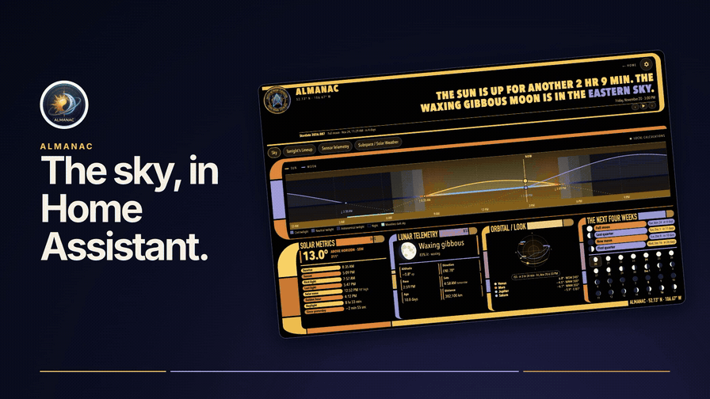](https://github.com/yanke7/Home-Assistant-Almanac/releases/download/v2.10.1/almanac-overview-1080p.mp4)

[Open the 1080p video with sound](https://github.com/yanke7/Home-Assistant-Almanac/releases/download/v2.10.1/almanac-overview-1080p.mp4)

## Dashboard features

| Feature | What you can see or do |
| --- | --- |
| **Interactive sky chart** | Drag or use the arrow keys to see how the Sun, Moon, and planets move throughout the local day. Press Escape or **Back to now** to return to the live sky. The chart separates civil, nautical, and astronomical twilight from night. A mint strip marks [moonless dark-sky windows](#tonights-dark-sky-window). |
| **Solar and lunar instruments** | See sunrise, sunset, first and last light, solar noon and its elevation, evening golden hour, and the change in daylight since yesterday. The Moon panel shows phase, tilt, illumination, altitude, compass direction, rise and set, age, and distance. The four-week calendar shows daily phases and upcoming phase transitions. |
| **Orbital / Look sky map** | See Sun and Moon paths and the positions of Venus, Mars, Jupiter, and Saturn. Planet labels and altitude, compass direction, and azimuth follow the timeline. A dashed arc and countdown show the [next predicted visible ISS pass](#iss-passes). |
| **Tonight’s Lineup** | Compare local rise, transit, and set times, apparent magnitude, and estimated evening or morning visibility for the four [bright planets](#bright-planets). Events after midnight carry their own date. |
| **Sensor Telemetry** | Use [Home Assistant weather or sensor entities](#sensor-telemetry) for cloud cover, seeing, transparency, temperature, and dew point. A condensation warning appears when the air temperature is within 2°C of the dew point or below it. |
| **Subspace / Solar Weather** | See NOAA’s [planetary Kp, solar wind speed, and Bz](#subspace--solar-weather). A location-based aurora alert combines NOAA’s OVATION forecast with local darkness. Individual readings show when they were recorded. |
| **Stardate and events** | Browse or pause the [header ticker](#stardate--astronomical-events) as it cycles through upcoming Moon phases, estimated meteor peaks with ideal hourly rates and local moonlight estimates, and equinox or solstice countdowns. |
| **Home Assistant automations** | Use [38 sensors and 4 binary sensors](#sensors-for-automations) as triggers or conditions, even with the dashboard closed. [Copyable examples](#example-automations) cover twilight lighting, bright moonrise, full Moon reminders, moonless darkness, and ISS passes. |
| **Themes, languages, and layouts** | Choose from [eight themes](#theme-gallery), including Star Trek and Follow Appearance, and [eleven languages](#languages). Settings remember your theme, language, and planet overlay choice in each browser. The card fits wide panels and stacks its instruments on phones. |

Almanac uses the location and time zone already configured in Home Assistant. Sun, Moon, planet, and astronomical event calculations run locally, including the interactive chart’s browser fallback. **Solar Weather and updated ISS predictions need internet access** from Home Assistant to reach NOAA and CelesTrak. Sensor Telemetry uses data from your configured Home Assistant entities.

## Theme gallery

Choose a theme with the gear on the card. These screenshots show the same sunset in Saskatoon so you can compare palettes. The preview uses local calculations. Select an image to see it full size.

### Star Trek

[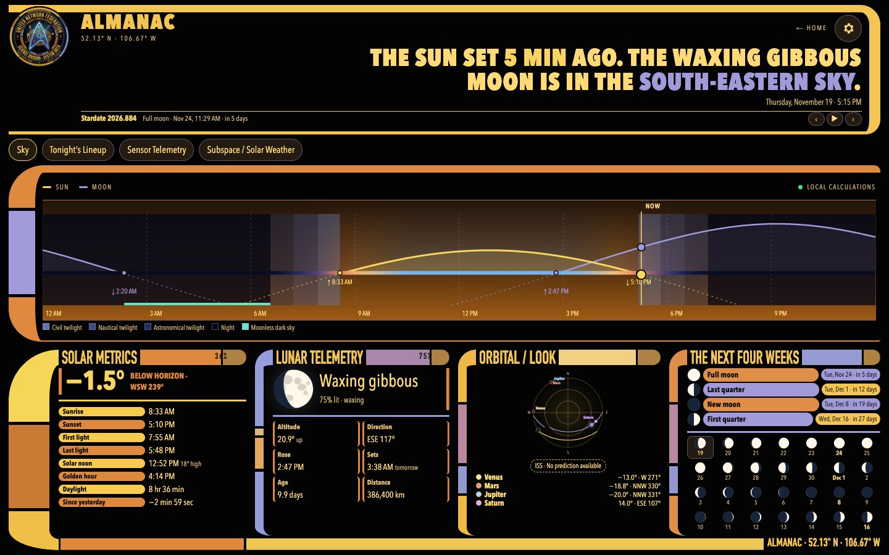](https://raw.githubusercontent.com/yanke7/Home-Assistant-Almanac/main/assets/screenshots/themes/trek.jpg)

[](https://raw.githubusercontent.com/yanke7/Home-Assistant-Almanac/main/assets/screenshots/themes/trek-instruments.jpg)

| Original | Brushed Steel |
| --- | --- |
| [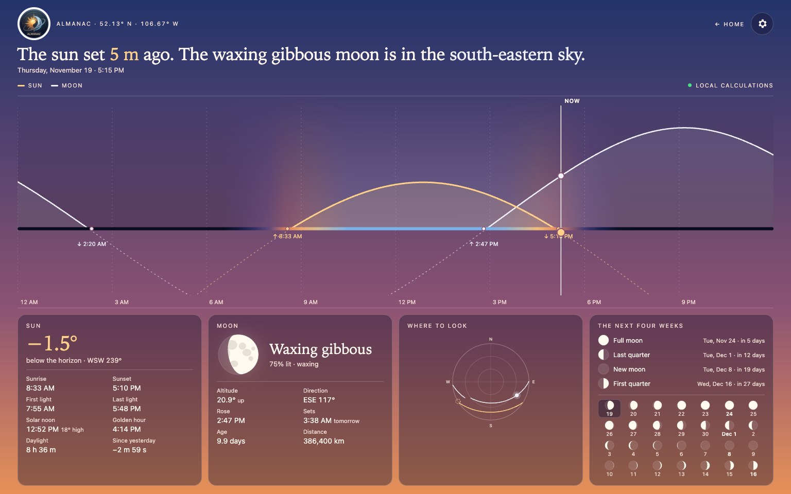](https://raw.githubusercontent.com/yanke7/Home-Assistant-Almanac/main/assets/screenshots/themes/original.jpg) | [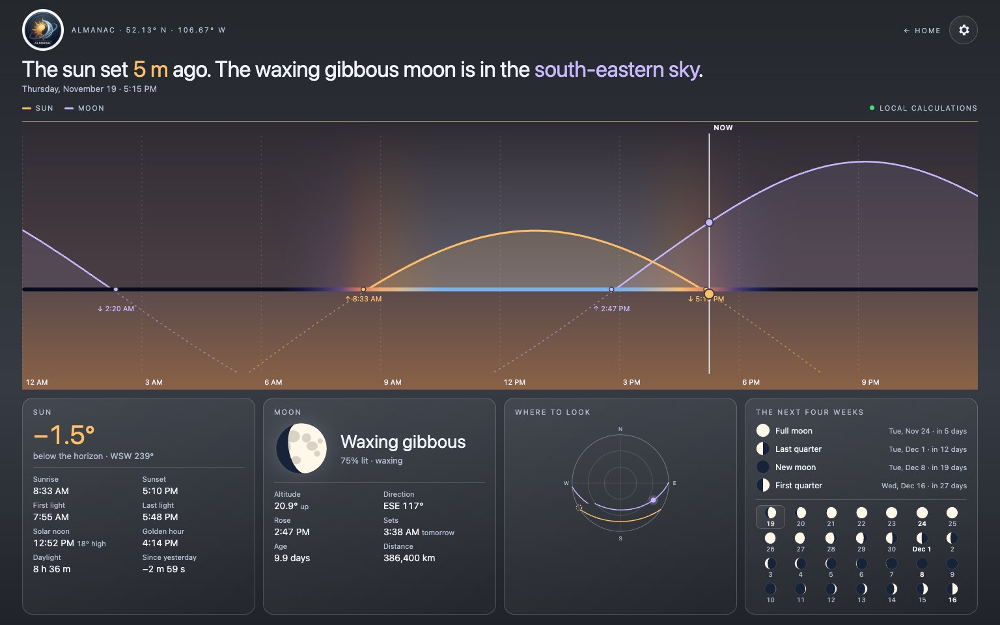](https://raw.githubusercontent.com/yanke7/Home-Assistant-Almanac/main/assets/screenshots/themes/steel.jpg) |

| Amber Relay | Neon Grid |
| --- | --- |
| [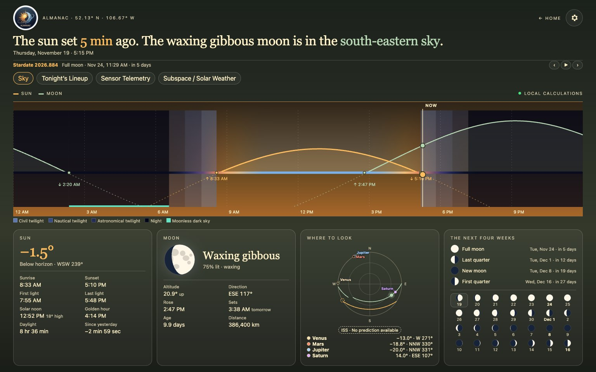](https://raw.githubusercontent.com/yanke7/Home-Assistant-Almanac/main/assets/screenshots/themes/relay.jpg) | [](https://raw.githubusercontent.com/yanke7/Home-Assistant-Almanac/main/assets/screenshots/themes/neon.jpg) |

| Midnight Drift | Aqua Current |
| --- | --- |
| [](https://raw.githubusercontent.com/yanke7/Home-Assistant-Almanac/main/assets/screenshots/themes/abyss.jpg) | [](https://raw.githubusercontent.com/yanke7/Home-Assistant-Almanac/main/assets/screenshots/themes/tide.jpg) |

### Follow Appearance

This preview shows the fallback colours. With the Appearance dashboard resource loaded, Almanac follows your shared palette, font and text size.

[](https://raw.githubusercontent.com/yanke7/Home-Assistant-Almanac/main/assets/screenshots/themes/appearance.jpg)

## Observing tools

These screenshots show the current dashboard tabs. Sensor Telemetry and Solar Weather use sample readings.

### Tonight’s Lineup

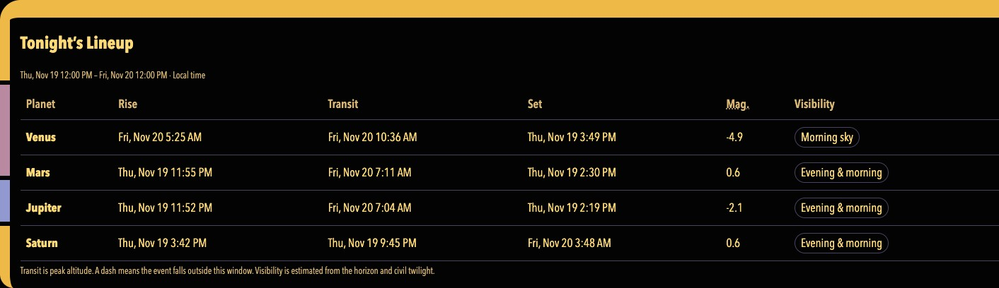

### Sensor Telemetry

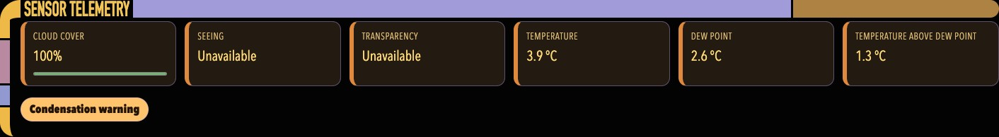

### Subspace / Solar Weather

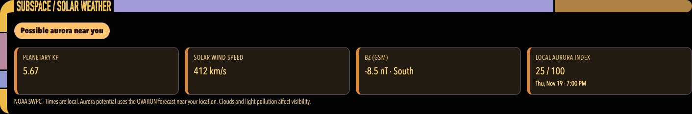

## Watch the sky change


A looping preview of the actual card at four times of day. The colours follow the sun automatically. [View still screenshots](#from-daylight-to-night).

## Almanac on your phone

The same card adapts to a narrow screen, with a touch-friendly sky chart and vertically stacked panels. Captured at a 390 × 844 phone viewport using the demo location and date. Tap a screenshot to see the complete scrolling view, including the moon, sky map, and phase calendar.

| Daylight | Sunset | Night |
| --- | --- | --- |
| [](https://raw.githubusercontent.com/yanke7/Home-Assistant-Almanac/main/assets/screenshots/phone-daylight-full.jpg) | [](https://raw.githubusercontent.com/yanke7/Home-Assistant-Almanac/main/assets/screenshots/phone-sunset-full.jpg) | [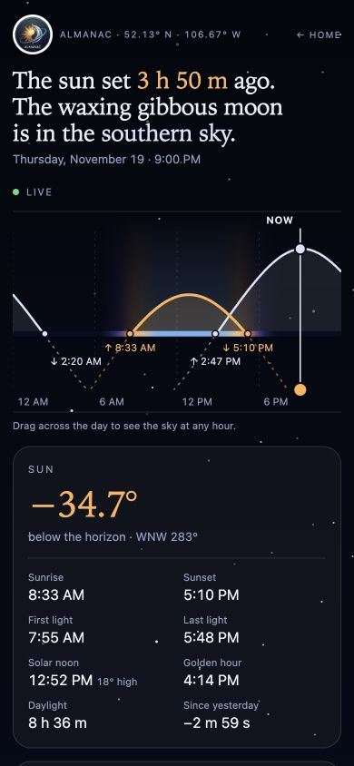](https://raw.githubusercontent.com/yanke7/Home-Assistant-Almanac/main/assets/screenshots/phone-night-full.jpg) |

## From daylight to night

The card changes its colours automatically with the sun’s elevation. These screenshots show the actual card with demo data for Saskatoon on November 19, 2026, including the bundled Almanac logo.

### Daylight · 1:00 PM

Clear blue skies and light panels.

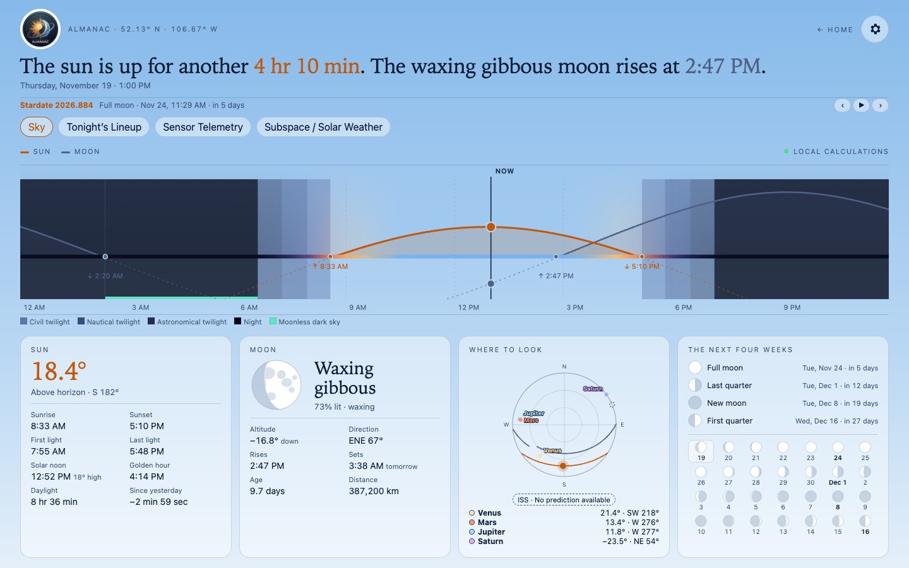

### Sunset · 5:15 PM

Warm orange and rose tones as the sun slips below the horizon.

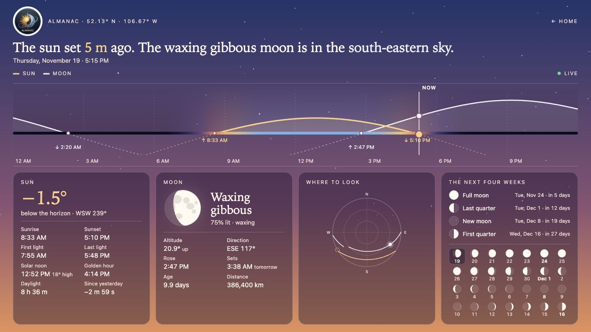

### Twilight · 6:00 PM

Purple and indigo tones after sunset.


### Night · 9:00 PM

Deep navy panels, stars, and a glowing moon.

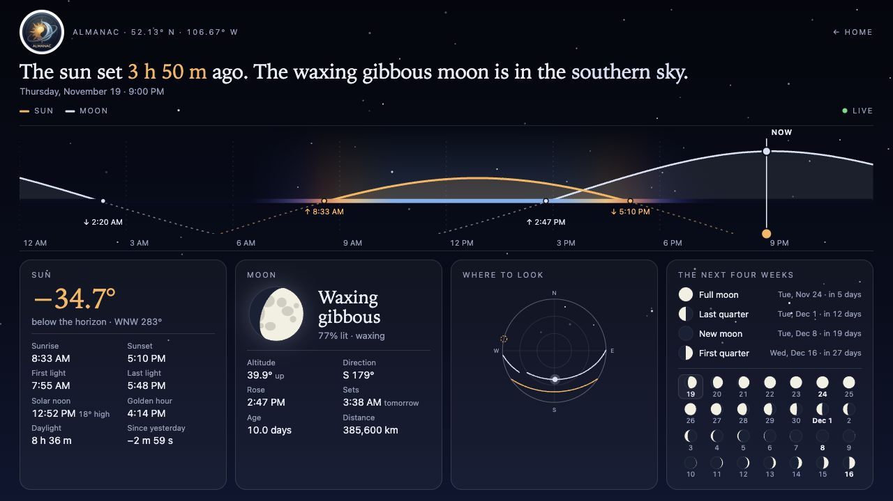

## Install with Marketplace or HACS

Requires Home Assistant **2026.1.0 or newer** (Almanac v2.3.1 onward).

1. Search for **Almanac** under **Settings → Marketplace** on Home Assistant 2026.11 or newer. On earlier supported versions, search in **HACS → Integrations**. You can also use the install badge above.
2. Download Almanac. Restart Home Assistant if requested so it discovers the new integration.
3. Go to **Settings → Devices & services → Add integration → Almanac** and confirm setup.
4. Add **Almanac Sky** to a panel dashboard view using the YAML below. The card loads automatically; no separate card download or dashboard resource is needed.

Almanac reads **Settings → System → General** for your home location and time zone. Changes are picked up within a minute. One Almanac entry is supported per Home Assistant instance.

Almanac is listed in the shared HACS and Home Assistant Marketplace catalog. If your local catalog hasn’t refreshed yet, you can add `https://github.com/yanke7/Home-Assistant-Almanac` as a custom repository under **Integration**.

## Themes and settings

Use the **Settings** gear beside Home on the Almanac card to choose a theme. The choice applies immediately and is remembered in this browser; different phones and wall displays can use different themes.

**Original** is the default and preserves the automatic daylight, sunset, twilight, and night colours. Other options are **Brushed Steel**, **Amber Relay**, **Neon Grid**, **Midnight Drift**, **Aqua Current**, **Star Trek**, and **Follow Appearance**. Follow Appearance uses the shared palette, font, and text size when the Appearance dashboard resource is loaded. Otherwise it uses your active Home Assistant colours and font. The theme only changes appearance; sensors and astronomical calculations stay the same.

### Display units

By default, Almanac uses Home Assistant’s temperature and distance units. **Settings → Units** lets you choose **Follow Home Assistant**, **Metric** (°C and km), or **US customary** (°F and mi). This preference is saved in the browser and applies to the card display.

## Stardate & astronomical events

The header rotates through the next two major Moon phases, meteor shower peaks, and equinoxes or solstices. Use the arrows to browse or pause it. The stardate is Almanac’s display of the UTC year and its fractional progress.

Meteor peaks are estimated from typical solar longitudes. Each entry shows the ideal hourly rate (ZHR), lunar illumination and a location-based moonlight estimate at the peak. Actual peak times and rates vary. [International Meteor Organization calendar](https://www.imo.net/calendar/)

### Languages

Choose **Language** in the card’s Settings. The browser saves the preference and applies it to the dashboard, ticker, Settings descriptions, help and accessibility labels, and local date and duration formatting. Available languages are English, French, Dutch, German, Spanish, Tagalog, Swedish, Italian, Polish, Danish and Norwegian Bokmål.

## Sensors for automations

Find all **38 sensors and 4 binary sensors** under **Settings → Devices & services → Almanac → Devices → Almanac**. Use them as automation triggers or conditions. They update every minute with the dashboard closed. Dragging the chart previews another time only in that browser. Names below use the default IDs; Home Assistant may add a suffix if an ID already exists.

| Entities | Values |
| --- | --- |
| `sensor.almanac_sun_elevation`, `sensor.almanac_sun_azimuth` | Degrees |
| `sensor.almanac_moon_elevation`, `sensor.almanac_moon_azimuth` | Degrees |
| `sensor.almanac_moon_phase`, `sensor.almanac_moon_illumination` | Phase state (listed below) and illumination percentage |
| `sensor.almanac_moon_age`, `sensor.almanac_moon_distance` | Days and kilometres |
| `sensor.almanac_daylight_duration`, `sensor.almanac_daylight_change` | Minutes of daylight; change in seconds since yesterday |
| `sensor.almanac_sky_period` | `day`, `golden`, `twilight`, or `night` |
| `sensor.almanac_next_sunrise`, `sensor.almanac_next_sunset` | Upcoming timestamps |
| `sensor.almanac_next_dawn`, `sensor.almanac_next_dusk` | Civil twilight timestamps |
| `sensor.almanac_next_solar_noon`, `sensor.almanac_next_evening_golden_hour` | Upcoming timestamps; evening golden hour begins at 6° solar elevation |
| `sensor.almanac_next_moonrise`, `sensor.almanac_next_moonset` | Upcoming timestamps |
| `binary_sensor.almanac_sun_above_horizon`, `binary_sensor.almanac_moon_above_horizon` | Above the apparent horizon |

| Additional dashboard entities (v2.3+) | Values |
| --- | --- |
| `sensor.almanac_sun_direction`, `sensor.almanac_moon_direction` | 16 compass points, clockwise from `N` through `NNE`, `NE`, … to `NNW` |
| `sensor.almanac_daylight_percentage` | Percentage of the current local day spent above the solar horizon, accounting for daylight-saving changes |
| `sensor.almanac_solar_noon_elevation` | Today's maximum sampled solar elevation in degrees |
| `binary_sensor.almanac_moon_waxing` | `on` during the waxing half of the lunar cycle and `off` during the waning half |
| `sensor.almanac_today_sunrise`, `sensor.almanac_today_sunset` | Today's sunrise and sunset |
| `sensor.almanac_today_dawn`, `sensor.almanac_today_dusk` | Today's first and last civil light |
| `sensor.almanac_today_solar_noon`, `sensor.almanac_today_evening_golden_hour` | Today's solar noon and evening descent through 6° |
| `sensor.almanac_today_moonrise`, `sensor.almanac_today_moonset` | First rise and set on today's local date |
| `sensor.almanac_next_new_moon`, `sensor.almanac_next_first_quarter`, `sensor.almanac_next_full_moon`, `sensor.almanac_next_last_quarter` | Upcoming phase timestamps from the lunar calendar |

The **today** timestamps keep their value after the event until local midnight. An event that does not occur today is `unknown`. The **next** timestamps roll forward after the event. The moon phase states are `new_moon`, `waxing_crescent`, `first_quarter`, `waxing_gibbous`, `full_moon`, `waning_gibbous`, `last_quarter`, and `waning_crescent`.

Upcoming sunrise, twilight, solar noon, golden hour and moonrise/set sensors search the remainder of today and the following two local days. When no event occurs in that window (for example during polar night), the event is `unknown`. Daylight duration still reports zero or the full local-day length during polar night/day. Values are approximate and not intended for navigation. Sensor timestamps are stored in UTC and displayed in your Home Assistant time zone.

If the backend is temporarily unavailable, the card labels its browser-only fallback **Local calculations**. That fallback does not update sensor entities.

## Bright planets

**Orbital / Look** (called **Where to look** in the other themes) plots Venus, Mars, Jupiter and Saturn by default. Turn off **Show planets on the sky map** in Settings to hide them. The dots and altitude, compass direction and azimuth readings update as you drag the timeline. Hollow dots on the rim mark planets below the horizon. The toggle is saved in your browser.

Positions are calculated offline using [JPL’s approximate planetary elements](https://ssd.jpl.nasa.gov/planets/approx_pos.html) for 1800–2050. The map shows where to look. Daylight, clouds and obstructions affect whether you can see a planet.

### Tonight’s Lineup

Open the **Tonight’s Lineup** tab for local rise, transit (peak altitude), set, apparent magnitude and estimated visibility for all four planets. The window runs from the middle of the current local day to the middle of the next, so events after midnight appear under their own date. A dash means that event does not occur in the window. Magnitude is approximate and uses [published planetary brightness models](https://arxiv.org/abs/1808.01973). Visibility uses the planet's altitude and a solar elevation below −6°, with evening or morning opportunities listed when applicable.

## ISS passes

**Orbital / Look** draws the next predicted ISS pass as a dashed mint arc and shows a countdown with its local start time. Home Assistant fetches public ISS orbital elements from [CelesTrak](https://celestrak.org/NORAD/documentation/gp-data-formats.php) and predicts passes locally with SGP4. It looks up to five days ahead for an ISS segment at least 10° above the horizon, in sunlight, while the observer’s Sun is below −6°. Weather and obstructions can affect what you see.

`sensor.almanac_next_iss_pass_start` is a timestamp sensor that updates even when the dashboard is closed. It is unknown when no pass can be predicted with fresh orbital data.

## Sensor Telemetry

Open **Sensor Telemetry** for current cloud cover, seeing, transparency, temperature and dew point. Almanac uses `weather.forecast_home` by default, or the sole weather entity if that ID is absent. Weather readings stay current while the sky timeline previews other times.

Almanac shows a **Condensation warning** when the outdoor temperature is at or below 2°C (3.6°F) above the dew point. The panel displays the threshold and temperature difference in the selected units. Temperature sensors can report °C, °F or K. Cloud cover and transparency expect numeric percentages. Seeing accepts a numeric percentage or arcseconds. Missing readings appear as **Unavailable**.

To choose your own sources, add the optional `telemetry` mapping in your Almanac card YAML. Keep only the entries you want to override.

```yaml
type: custom:almanac-sky-card
telemetry:
  weather_entity: weather.forecast_home
  cloud_cover_entity: sensor.outdoor_cloud_cover
  temperature_entity: sensor.outdoor_temperature
  dew_point_entity: sensor.outdoor_dew_point
  seeing_entity: sensor.astronomical_seeing
  transparency_entity: sensor.sky_transparency
```

## Subspace / Solar Weather

Open the **Subspace / Solar Weather** tab for NOAA Space Weather Prediction Center readings. It shows estimated planetary Kp, solar wind speed in km/s, and the northward or southward Bz component in nT (GSM). Each reading shows its observation time in your local time zone.

Almanac shows **Possible aurora near you** when NOAA’s OVATION forecast reaches an index of 20 within 500 km of your Home Assistant location and the Sun is below −6° at the forecast time (or now if the forecast time has just passed). This is an estimate based on nearby auroral activity and darkness. Clouds, light pollution, and your horizon affect what you can see. The local index is the value at the nearest forecast grid cell.

The tab needs internet access from Home Assistant. It refreshes on demand while open, shares a five-minute NOAA cache across clients, and marks expired observations as unavailable. The core Almanac calculations run locally. [NOAA aurora forecast](https://www.swpc.noaa.gov/products/aurora-30-minute-forecast)

## Tonight’s dark-sky window

The timeline shades civil, nautical and astronomical twilight, then night. The mint strip marks times when the Sun is below −18° and the Moon is below Almanac’s apparent horizon (−0.833°). The chart shows intervals within its displayed local day.

| Entity | What it reports |
| --- | --- |
| `sensor.almanac_dark_sky_window_start` | Start of the current or next moonless dark-sky window |
| `sensor.almanac_dark_sky_window_end` | End of that same window |
| `binary_sensor.almanac_moonless_dark_sky` | `on` when the live sky meets both conditions |

The sensors keep the same pair of timestamps throughout an active window, including across midnight. Almanac searches through the next two local days and reports `unknown` for missing windows or endpoints beyond its search range. Conditions are based on Sun and Moon positions. Clouds and light pollution affect actual visibility.

## Example automations

Each block is one automation. In **Settings → Automations & scenes**, create an empty automation, open **Edit in YAML**, and paste one example. Replace the example light with your own entity ID.

### Turn on a porch light when evening twilight begins

The transition from golden hour to twilight selects the evening crossing.

```yaml
alias: Almanac - Porch light at evening twilight
triggers:
  - trigger: state
    entity_id: sensor.almanac_sky_period
    from: "golden"
    to: "twilight"
actions:
  - action: light.turn_on
    target:
      entity_id: light.porch
```

### Notify when a bright moon rises

This checks illumination at moonrise. The notification appears in Home Assistant.

```yaml
alias: Almanac - Bright moon rising
triggers:
  - trigger: state
    entity_id: binary_sensor.almanac_moon_above_horizon
    from: "off"
    to: "on"
conditions:
  - condition: numeric_state
    entity_id: sensor.almanac_moon_illumination
    above: 80
actions:
  - action: persistent_notification.create
    data:
      title: Bright moon rising
      message: >-
        Look {{ states('sensor.almanac_moon_direction') }}.
        The moon is {{ states('sensor.almanac_moon_illumination') | float(0) | round(0) | int }}% illuminated.
```

### Schedule a reminder at the predicted full moon

Use a time trigger to fire at the timestamp held by an event sensor.

```yaml
alias: Almanac - Full moon reminder
triggers:
  - trigger: time
    at: sensor.almanac_next_full_moon
actions:
  - action: persistent_notification.create
    data:
      title: Full moon
      message: The moon has reached its predicted full phase.
```

### Notify when a moonless dark-sky window begins

```yaml
alias: Almanac - Moonless dark sky
triggers:
  - trigger: state
    entity_id: binary_sensor.almanac_moonless_dark_sky
    from: "off"
    to: "on"
actions:
  - action: persistent_notification.create
    data:
      title: Moonless dark sky
      message: The Sun is below −18° and the Moon is below the horizon.
```

### Notify when a predicted ISS pass starts

```yaml
alias: Almanac - ISS pass
triggers:
  - trigger: time
    at: sensor.almanac_next_iss_pass_start
actions:
  - action: persistent_notification.create
    data:
      title: ISS pass
      message: Open Almanac’s sky map for the predicted path.
```

## Configure

Use a panel view for the full-page design:

```yaml
views:
  - title: Almanac
    path: almanac
    type: panel
    cards:
      - type: custom:almanac-sky-card
        home_path: /lovelace/0
```

For an existing panel view, add this card in its YAML editor:

```yaml
type: custom:almanac-sky-card
```

| Option | Default | Description |
| --- | --- | --- |
| `type` | Required | `custom:almanac-sky-card` |
| `telemetry` | Automatic weather source | Optional entity overrides for Sensor Telemetry. |
| `home_path` | `/lovelace/0` | Local dashboard path for the Home link. |

The location and time zone come from Home Assistant's general settings. Use **Settings → Language** to change the dashboard language and local date formatting. Astronomical values are approximate.

## Manual installation

Copy `custom_components/almanac` from the latest release into `/config/custom_components/almanac`, restart Home Assistant, then add **Almanac** under **Settings → Devices & services**. The dashboard JavaScript and logo are included in that folder.

## Migrating from the 1.x standalone card

Version 2 combines the dashboard card and sensors in one integration. The card type remains `custom:almanac-sky-card`; existing views and `home_path` settings can be kept.

1. Save your current resource URL and dashboard YAML so you can return to version 1.0.3 if needed.
2. Download the 2.x release ZIP and copy `custom_components/almanac` to your Home Assistant configuration directory. Restart and add the integration under Devices & services. Verify the Almanac sensors are available.
3. Remove the old standalone card download from Marketplace/HACS (or remove its manual dashboard resource). Keep the dashboard view itself. The integration now supplies the card automatically.
4. If the repository is still registered as **Dashboard**, remove that custom-repository registration and add the same repository as **Integration**, then download the 2.x version for future updates.
5. Reload your browser. If an old card is still loaded, hard-refresh it. The live card and sensors now use the integration.

For a fresh installation, use the normal Integration instructions above. Do not register both the standalone card resource and the bundled card.

Rollback: disable the Almanac integration, reinstall the **Dashboard** package at `v1.0.3` (or restore its saved JavaScript module resource), restart Home Assistant, and reload the browser. Existing dashboard YAML remains compatible.

## Development

To test the minimum supported version, install `homeassistant==2026.1.0` and `sgp4==2.25` with Python 3.13. CI also runs the backend tests with `homeassistant==2026.11.0` in a Python 3.14 virtual environment. No JavaScript build step or npm dependencies are required. Keep the root `almanac-sky-card.js` and `custom_components/almanac/www/almanac-sky-card.js` identical when editing the card. Serve this directory with `python3 -m http.server 8000`, then open `http://localhost:8000/preview.html` for a demo with sample location data. Add `?time=2026-11-19T23:15:00Z` to freeze the demo clock for a reproducible sunset preview; this affects only the demo page.

```sh
node --check almanac-sky-card.js
node verify-day.cjs
node tests/verify-backend.cjs
python -m unittest discover -s tests -p 'test_*.py'
```

The regression checks cover short, long, and ordinary local days, a half-hour time zone, chart bounds, keyboard/pointer selection, and calendar dates. GitHub Actions also validates the repository with the HACS action.

## License

GNU General Public License v3.0 only. See [LICENSE](LICENSE).
